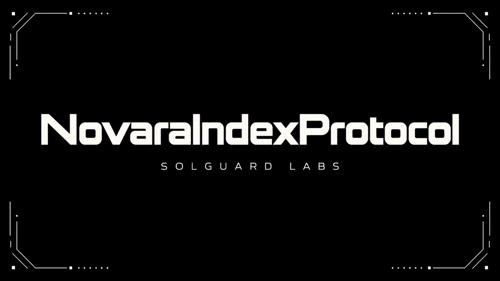
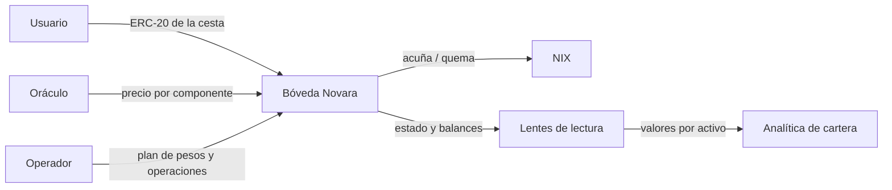

# Novara Index Protocol



Novara Index Protocol emite `NIX`, una participación ERC-20 sobre una cesta de activos custodiada por una bóveda Vyper. El repositorio contiene la lógica de emisión y redención en especie, precios, políticas operativas y contratos auxiliares de lectura y análisis. Es una implementación de referencia: los comandos de este repositorio ejecutan contratos en una EVM local; no acreditan un despliegue en una red pública.

## Modelo del protocolo



La bóveda registra componentes con un peso objetivo en puntos básicos, un precio por activo y modos de participación en emisión, redención y NAV. `NIX` tiene 18 decimales. El oráculo expresa precios en unidades de cuenta con escala `10¹⁸`; los importes de los ejemplos usan tokens de 18 decimales. En una integración con otros decimales hay que normalizar cantidades antes de aplicar estas fórmulas.

Para un depósito inicial, `shares = valor_del_depósito`. Con participaciones en circulación, `shares = valor_del_depósito × supply / NAV_previo`, con redondeo entero hacia abajo. El valor del depósito suma `cantidad_i × precio_i / 10¹⁸` y cada componente debe respetar su peso objetivo dentro de la tolerancia configurada. Una redención en especie calcula la cantidad de cada componente habilitado con `balance_i × shares / supply_previo`; el mínimo de valor y las comisiones se verifican antes de transferir.

Los contratos auxiliares de `src/modules/`, `src/policy/` y `src/lens/` son piezas desplegables de manera independiente. Su presencia en el repositorio no implica que la bóveda los invoque automáticamente: las integraciones deben definir roles, fuentes de datos y procedimientos operativos explícitos.

## Inicio local

Requisitos: Python 3.12, Vyper 0.4.3 y las dependencias fijadas en `requirements.txt`.

```bash
python -m venv .venv
source .venv/bin/activate
python -m pip install -r requirements.txt
bash scripts/ci.sh
```

En PowerShell, sustituye la activación por `.\.venv\Scripts\Activate.ps1`. Para ejecutar únicamente pruebas: `bash scripts/tests.sh` o `python -m pytest -q`. `scripts/compile_vyper.py` compila todos los contratos de `src/` sin desplegarlos.

## Ejemplo económico

Con NAV inicial de 100 000 unidades y pesos 50/30/20, los valores objetivo son 50 000, 30 000 y 20 000. Si los precios normalizados son 1, 2 000 y 40 000, las cantidades de una cesta de 18 decimales son 50 000, 15 y 0,5 tokens. Una emisión inicial de esa cesta acuña 100 000 `NIX`, antes de cualquier comisión configurada. El ejemplo supone precios vigentes, permisos ERC-20 aprobados y todos los componentes activos.

La analítica de `NovaraPortfolioAnalytics` calcula pesos realizados, desviación absoluta, rotación teórica y concentración. Para valores 50/30/20 y objetivo 45/35/20, la rotación mínima teórica es 500 bps y el índice de concentración es 3 800 bps. Estas métricas son lecturas, no autorizaciones de rebalanceo ni límites ejecutados por la bóveda.

## Controles y operación

- `owner` configura componentes, parámetros y direcciones críticas; `keeper` ejecuta operaciones autorizadas; `guardian` puede pausar componentes.
- Los feeds exigen precio positivo, límites configurados y vigencia temporal.
- La emisión valida composición, orden de tokens, tolerancia y mínimo de participaciones; la redención valida saldo, mínimo de valor y estado de componentes.
- Los planes de pesos tienen una ventana temporal y consolidación explícita. Las sustituciones de componentes también requieren apertura, aprovisionamiento y cierre operativo.
- La bóveda impide reentrada en emisión y redención mediante un bloqueo local.

Consulta [arquitectura](docs/arquitectura.md), [modelo económico](docs/modelo-economico.md), [integración](docs/integracion.md), [operación](docs/operacion.md) y [riesgos](docs/riesgos.md). La [política de seguridad](SECURITY.md) describe el alcance verificable de los controles.

## Verificación y versión

`scripts/ci.sh` compila Vyper, comprueba Ruff y ejecuta pytest. GitHub Actions ejecuta el mismo script en cada push y PR. La rama `production`, el tag anotado `v1.0.0` y el release `Production 1.0.0` identifican un mismo commit cuando se publica una entrega estable; el workflow de integridad verifica esa convergencia. El nombre del release no implica despliegue on-chain. Los cambios se registran en [CHANGELOG.md](CHANGELOG.md).

## Estructura

```text
src/vault/       bóveda y accounting de participaciones
src/token/       token NIX
src/oracle/      precios y vigencia de feeds
src/analytics/   métricas puras de cartera y escenarios
src/lens/        lecturas agregadas
src/modules/     coordinación y registros operativos auxiliares
src/policy/      políticas e indicadores auxiliares
tests/          integración EVM local y analítica
scripts/        compilación, tests y CI
docs/           contratos operativos y ejemplos
```
