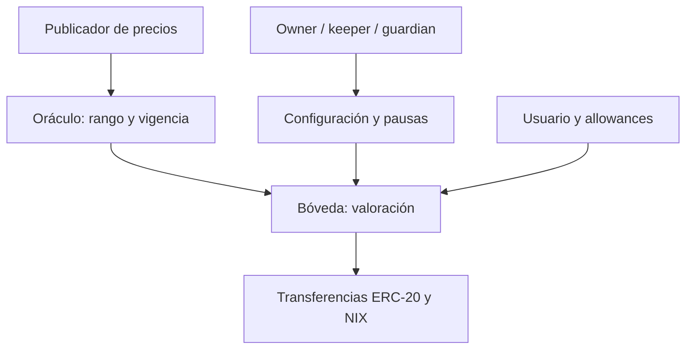

# Política de seguridad

## Alcance

El perímetro principal es `src/vault/NovaraIndexProtocol.vy`, el token `NIX` y el oráculo. Los contratos de módulos, políticas, lentes y analítica son componentes auxiliares con roles y despliegue independientes. `src/mocks/` solo aporta activos de prueba. Este repositorio no declara una auditoría externa ni un despliegue en una red pública.

## Modelo de confianza

`owner` controla la configuración estructural y puede delegar `keeper` y `guardian`. `keeper` opera planes y aprovisionamiento; `guardian` pausa componentes. Estas claves son superficies de gobierno privilegiadas: un operador debe custodiar, rotar y supervisar las claves fuera de este código. Los precios dependen de un publicador autorizado y de los límites de cada feed. Los ERC-20 integrados deben cumplir las transferencias y la escala de unidades esperadas.

## Invariantes esperadas

- La suma de pesos de componentes habilitados para emisión es 10 000 bps antes de aceptar un depósito.
- Un depósito usa exactamente el orden de componentes registrado y respeta desviación y mínimo de participaciones.
- Una redención no quema más participaciones que las disponibles y cumple el mínimo de valor indicado por el usuario.
- Los precios empleados en operaciones deben ser positivos, estar dentro de sus rangos y no exceder el plazo de vigencia.
- Los cambios de peso se consolidan solo tras su ventana; las pausas bloquean operaciones que dependan del componente pausado.
- La analítica de cartera es de solo lectura y no sustituye la validación transaccional de la bóveda.

## Validación disponible

`bash scripts/ci.sh` compila todos los contratos con Vyper 0.4.3, comprueba estilo y lint de Python con Ruff y ejecuta pruebas locales con Titanoboa. Las pruebas cubren emisión, composición, redención, pausas, cambios de pesos, cierre de sustitución y métricas de cartera. La suite no equivale a una auditoría formal ni prueba propiedades de todos los tokens o feeds posibles.

Las dependencias Python están fijadas en `requirements.txt`; Dependabot vigila pip y GitHub Actions. La verificación de release compara `main`, `production` y el tag anotado para impedir una entrega con referencias divergentes.

## Notificación responsable

No publiques detalles sensibles en una issue. Un reporte debe incluir versión y commit, impacto, precondiciones, transiciones de estado observadas, pasos mínimos de reproducción y mitigación propuesta. Utiliza los mecanismos privados de reporte de seguridad de GitHub cuando estén habilitados para el repositorio; en caso contrario, contacta al propietario por un canal privado antes de divulgar detalles.
