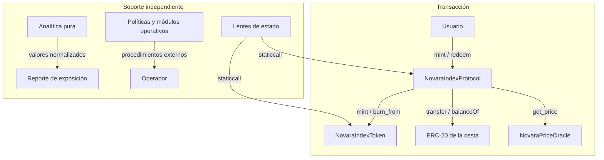

# Arquitectura de Novara

## Límites de componentes

La bóveda es el único contrato que recibe los activos de la cesta y emite o quema `NIX`. El token mantiene supply y saldos. El oráculo conserva feed, marca temporal, banda de precios y pausa por activo. La bóveda consulta el oráculo en operaciones que precisan valoración y consulta balances directamente en cada ERC-20. No existe una base de datos externa necesaria para la suite local.

La separación entre transacción y soporte importa: los módulos `ReplacementCoordinator`, `RebalancePlanner`, `OperationsLedger` y `RedemptionQueue` no son llamadas internas de la bóveda. Una instalación que los utilice debe especificar qué actor traslada la información entre ellos y qué fuente es la autoridad en cada paso.

## Estado de la bóveda

Cada componente tiene flags de listado, actividad, pausa y participación en emisión, redención y NAV; además conserva peso vigente y objetivo, límites y metadatos operativos. El array de componentes impone un máximo de 16 y preserva el orden exigido por `mint` y `preview_mint`. Las vistas `component_at` y `get_component` permiten construir entradas sin depender de un índice externo.

El bloqueo `locked` se activa durante `mint` y `redeem`, antes de cualquier llamada ERC-20 externa, y se libera al finalizar. Las operaciones administrativas tienen permisos propios. Esta división debe reflejarse en el análisis de reentrada y en la custodia de claves.

## Superficie de lectura

`NovaraIndexLens` compone NAV, supply, PPS y filas por componente. `NovaraPortfolioAnalytics` recibe valores ya normalizados, sin permisos ni storage: no realiza `staticcall` a feeds y no toma decisiones para la bóveda. Una integración debe distinguir métricas informativas de controles on-chain que sí hacen revertir una transacción.
