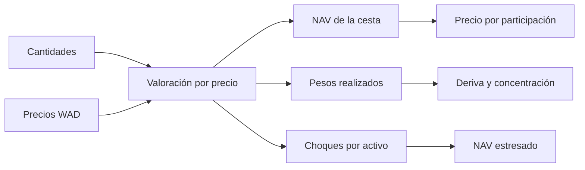

# Modelo económico

## Unidades y valoración

`WAD = 10¹⁸` y `BPS = 10 000`. El oráculo devuelve precio en WAD. Para un componente con cantidad `qᵢ` y precio `pᵢ`, el valor normalizado es `vᵢ = floor(qᵢ × pᵢ / WAD)`. `NAV` suma los valores de componentes activos, habilitados para NAV y no pausados. El contrato no lee `decimals()` del token; el integrador debe asegurarse de que las unidades de cantidad y precio que suministra son coherentes.

## Emisión y redención

Para `supply = 0`, `shares_brutas = valor_depositado`. En una cesta existente, `shares_brutas = floor(valor_depositado × supply / NAV_previo)`. La comisión de emisión, si se configura, se acuña al tesoro en participaciones. La función exige composición contra pesos de los componentes habilitados y compara cada valor con `floor(valor_depositado × peso / BPS)` dentro de la tolerancia configurada.

La redención quema `shares` y transfiere cada cantidad en especie `floor(balanceᵢ × shares / supply_previo)`, con una comisión por componente si corresponde. La cotización previa suma el valor de las salidas habilitadas y aplica la comisión al valor declarado; `_min_value` protege al solicitante frente a un resultado inferior al exigido. El redondeo entero puede dejar unidades residuales en el vault. No se promete una paridad fija de `NIX` con una moneda externa.

### Ejemplo nominal

| Componente | Peso | Precio | Cantidad inicial | Valor |
| --- | ---: | ---: | ---: | ---: |
| nUSD | 5 000 bps | 1 | 50 000 | 50 000 |
| nETH | 3 000 bps | 2 000 | 15 | 30 000 |
| nBTC | 2 000 bps | 40 000 | 0,5 | 20 000 |

Con supply inicial 100 000 `NIX` y comisiones cero, una redención nominal de 25 000 `NIX` recibe 25 % de cada balance elegible. La tabla utiliza tokens de 18 decimales y precios vigentes; un activo con otros decimales requiere adaptar cantidades/precios de forma consistente.

## Analítica de asignación

`allocation_report` calcula el peso realizado `floor(vᵢ × BPS / Σv)`, el desvío absoluto respecto al objetivo y `rotación = floor(Σ|peso_realizadoᵢ − peso_objetivoᵢ| / 2)`. Esta rotación es un límite teórico de transferencia de valor entre componentes, no una orden negociable ni una predicción de costes. El indicador de concentración `floor(Σpeso_realizadoᵢ² / BPS)` vale 10 000 para una cesta de un solo activo y disminuye al diversificar. El truncamiento entero puede hacer que la suma de pesos realizados sea ligeramente menor que 10 000.

`scenario_nav` aplica un choque por componente: `floor(vᵢ × shock_bpsᵢ / BPS)` se suma o resta según dirección. Devuelve NAV inicial, NAV estresado y pérdida relativa en bps (cero si el escenario mejora el NAV). Solo admite choques de 0 a 10 000 bps y no modela correlación, profundidad de mercado, slippage ni movimientos de supply.

