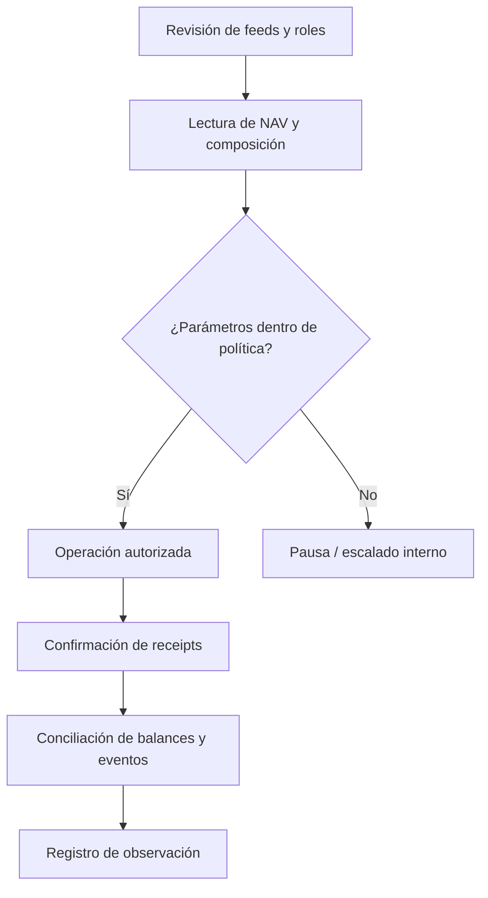

# Operación y seguimiento

## Cadencia de control

Antes de una ventana operativa, el operador verifica edad y banda de los feeds, pesos vigentes, estado de pausas, supply y NAV. Durante la ventana registra transacciones y receipts, contrasta balances del vault con eventos y vigila la diferencia entre peso objetivo y realizado. Tras finalizar, repite lecturas y conserva el commit de software utilizado para construir el cliente.



Un plan de pesos usa `schedule_weight_plan` con inicio y fin; `commit_weight_plan` solo consolida tras el fin. La sustitución de un componente dispone de `begin_component_replacement`, `stage_liquidity` y `finalize_component_replacement`. El operador debe conservar una traza de cada transacción y comprobar el estado efectivo de ambos componentes antes y después de la ventana. Los módulos auxiliares de planificación y registro pueden complementar la operación, pero no ejecutan la bóveda por sí mismos.

## Señales observables

`NovaraIndexLens.index_summary` informa NAV, supply, PPS y estado de sustitución. `component_row` expone estado, balance y valor. `NovaraInvariantMonitor` permite registrar observaciones y marcar saltos de PPS o desviaciones de peso; no bloquea transacciones de la bóveda. Una alerta debe disparar investigación y, si procede, pausa por el guardian; no debe interpretarse como prueba automática de una causa concreta.

## Comprobaciones reproducibles

```bash
bash scripts/tests.sh
bash scripts/ci.sh
```

Para una entrega, confirma que la suite local y GitHub Actions pasan sobre el mismo commit. La rama `production`, el tag anotado y el release deben coincidir con `main`; el nombre `Production 1.0.0` identifica un artefacto de código y no una afirmación de despliegue en una cadena.
